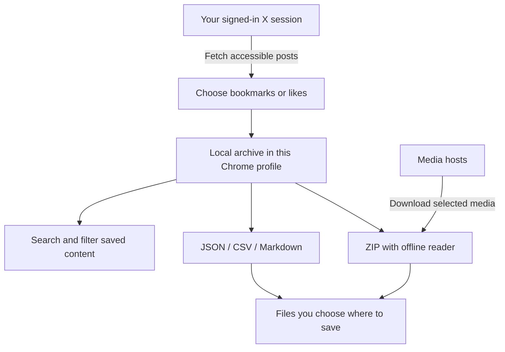

# Xkeeps

> Saved it on X. Can't find it later?

**Keep your bookmarks and likes in a local archive you can search, export and read offline.**

[](LICENSE)
[](#install-for-free)
[](https://github.com/JinHanAI/Xkeeps-Extension/releases/latest)

**[Download v0.9.2 for free](https://github.com/JinHanAI/Xkeeps-Extension/releases/download/v0.9.2/Xkeeps-v0.9.2-local.zip)** · **[中文说明](README.zh-CN.md)** · [Website](https://xkeeps.jinhanai.com/) · [Watch the 34-second demo](https://x.com/AIJinHan/status/2113300249217577313)

Desktop Chrome · Manual installation · No build tools needed


[See it in use](#see-it-in-use) · [Install](#install-for-free) · [First export](#your-first-export) · [How it works](#how-it-works) · [Privacy](#privacy-and-limits) · [FAQ](#questions-before-you-install)

## From saved posts to useful files

You remember an idea from a post, but not its author or exact wording. Or you want to keep a useful thread with your notes, rather than leave another link to revisit later.

Xkeeps gives you a local copy to work with. Bookmarks and likes stay separate, each X account has its own archives, and exports use formats you can open outside the extension.

| What you want to do | What Xkeeps provides |
| --- | --- |
| Find a saved post | Search local text, authors and links; filter by date or folder |
| Keep a backup | Export cumulative JSON archives for later import |
| Organize research | Export CSV for spreadsheets or Markdown for notes |
| Read without a connection | Download a ZIP with a reader and selected media that downloaded successfully |
| Use more than one X account | Keep archives separated by account and by bookmarks/likes |

## See it in use

<table>
<tr><th>Find something you saved</th><th>Read your downloaded archive</th></tr>
<tr>
<td></td>
<td></td>
</tr>
</table>

All screenshots use synthetic demo data, not a personal archive. Open an image to view it at full size. The interface supports English and Chinese; exported post text stays in its original language.

## Install for free

Use **desktop Chrome 120 or later**. You do not need Node.js, npm or a build step.

1. **[Download the installation ZIP](https://github.com/JinHanAI/Xkeeps-Extension/releases/download/v0.9.2/Xkeeps-v0.9.2-local.zip).** Choose `Xkeeps-v0.9.2-local.zip`, not GitHub's automatic “Source code” archives. [Release notes and checksums](https://github.com/JinHanAI/Xkeeps-Extension/releases/tag/v0.9.2).
2. **Extract it into a folder you will keep.** Do not load the ZIP itself or delete the folder after installing.
3. **Open `chrome://extensions/`** in Chrome's address bar and enable **Developer mode**.
4. **Choose “Load unpacked”.** Select `Xkeeps-v0.9.2-local`, the folder directly containing `manifest.json`.
5. **Connect your X account.** Sign in to X in the same browser profile and open `x.com` once. Open Xkeeps from Chrome's extensions menu and confirm the connected account.

**Ready to use:** Xkeeps opens its home screen and shows the expected account. If connection information is missing, revisit X while signed in, then reopen Xkeeps.

This download is a manual installation and does not receive Chrome Web Store automatic updates. The [website](https://xkeeps.jinhanai.com/) lists available distribution channels; a GitHub release does not mean a store listing is live.

## Your first export

1. On **Home**, choose **Bookmarks** or **Likes** and run a **Full update**. Keep the page open and review the result, including any partial or failed requests.
2. Open **Browse** and search for a word from a saved post. Search works on content already in the local archive.
3. Return to **Home** and choose the download range and formats. For a backup, select **All saved content** and **JSON**. Repeat for the other content source.
4. For offline reading with images or videos, select the media you need. Extract the resulting ZIP, keep its files together, and open the included HTML reader.

| Format | Best for | Can restore an archive? |
| --- | --- | --- |
| JSON | Backup and import | Yes, for the matching account and content source |
| CSV | Spreadsheet review | No |
| Markdown | Reading and notes | No |
| ZIP with reader and selected media | Offline reading | Use the included JSON for import, if selected |

**Latest collection** includes everything observed in the latest run, including existing items. It does not mean “new items only”. Use **All saved content** for cumulative backups. Download date filters use the original post date, not when you bookmarked or liked it.

## How it works



Fetching posts contacts X; downloading media contacts its hosts. Searching saved content uses the local archive. Xkeeps does not upload your archive to the developer.

## Questions before you install

<details>
<summary><strong>Will this retrieve every bookmark or like?</strong></summary>

Not necessarily. X's interfaces, login state, access restrictions and rate limits affect what is returned. A completed operation is not proof that every historical post was retrieved. Check the result and keep prior backups.

</details>

<details>
<summary><strong>How do I update or move to a different installation?</strong></summary>

Finish active tasks and export **both cumulative JSON archives** first. Keep the same unpacked folder and extension identity when reloading a local version. A store installation, different extension ID or different browser profile has separate storage. Import and compare both JSON archives there before removing the old installation. Do not assume automatic migration.

</details>

<details>
<summary><strong>Why is an image or video missing offline?</strong></summary>

Only successfully downloaded media can be displayed offline. A saved media URL is not a saved file. Keep the entire extracted ZIP folder together. Media previews that have not been downloaded still require a network connection.

</details>

<details>
<summary><strong>Does it back up my account automatically?</strong></summary>

Optional scheduled checks are experimental and off by default. They require Chrome to be running and the computer to be awake; they check at most one page per run and do not download media. Export files regularly. Extension storage is not a separate backup.

</details>

## Privacy and limits

- Archives and usage events stay in your browser; there is no developer upload endpoint for them.
- Fetching posts uses your local X session and sends requests to X. Media previews and downloads contact their hosts.
- Local storage is **not an encrypted vault**. Session connection information and exported archives can be sensitive.
- Do not attach private archives, cookies or authorization headers to public issues. Send only a version number, reproduction steps and sanitized errors.

Read [privacy and permissions](docs/privacy.md) and [security reporting](SECURITY.md). A detailed [Chinese usage guide](https://github.com/JinHanAI/Xkeeps-Extension/blob/3e873b67f557cb7e8198bd1fb6ffa86885e85a22/docs/usage.zh-CN.md) covers update modes, download limits and the standalone viewer.

## Development

Load the repository root as an unpacked extension to run from source. Tests and packaging use **Node.js 24** and the system `zip` command; no npm packages are required.

```sh
node --test tests/*.test.mjs
node scripts/package-local.mjs
node scripts/package-local.mjs --store
```

Packaging uses an explicit file list. Local packages have one top-level folder; store packages have `manifest.json` at their root. Browser fixtures use synthetic examples; automated checks do not authenticate to X or prove a store installation works. See [maintenance](docs/maintenance.md) and [contributing](CONTRIBUTING.md).

## Maintainer and credits

Maintained by **[JinHanAI](https://www.jinhanai.com/)**. Follow [@AIJinHan on X](https://x.com/AIJinHan) for updates, or [report a reproducible issue](https://github.com/JinHanAI/Xkeeps-Extension/issues).

Xkeeps builds on [xarchive](https://github.com/sytelus/xarchive). The original copyright and MIT license remain in [LICENSE](LICENSE); Dexie.js and bundled helper notices are preserved in [third-party notices](docs/third-party-notices.md).

An independent project, not affiliated with or endorsed by X. Brand names identify the project and maintainer; they do not add restrictions to the MIT code license or imply endorsement of third-party forks.
