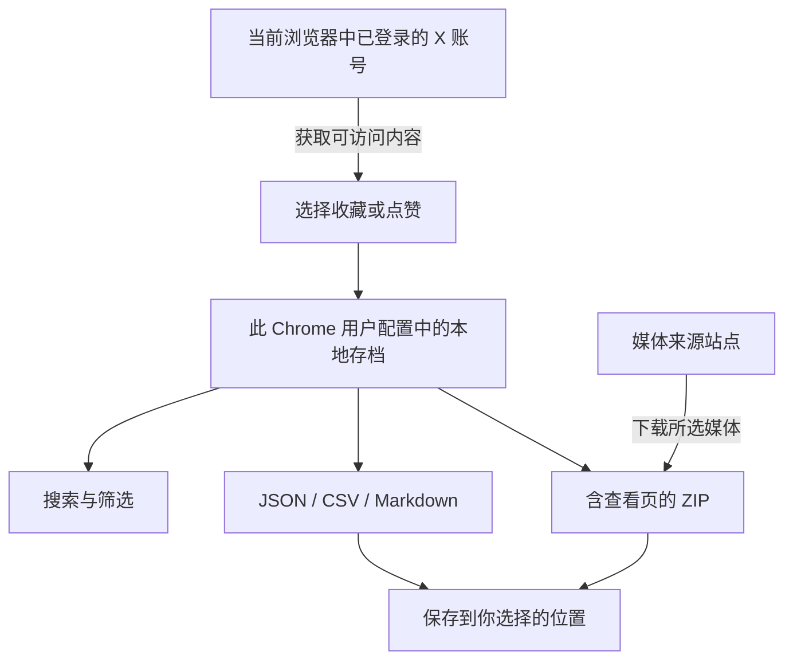

# Xkeeps

> 收藏时觉得以后一定用得上，真正要用时却找不到了。

**把 X 收藏和点赞存到本地，找得回，也用得上。**

[](LICENSE)
[](#免费安装)
[](https://github.com/JinHanAI/Xkeeps-Extension/releases/latest)

**[免费下载 v0.9.2](https://github.com/JinHanAI/Xkeeps-Extension/releases/download/v0.9.2/Xkeeps-v0.9.2-local.zip)** · **[English](README.md)** · [中文官网](https://xkeeps.jinhanai.com/zh/) · [34 秒演示视频（英文）](https://x.com/AIJinHan/status/2113300249217577313)

桌面 Chrome · 手动安装 · 无需编程或构建工具


[使用效果](#使用效果) · [免费安装](#免费安装) · [第一次导出](#第一次导出) · [工作原理](#工作原理) · [常见问题](#常见问题) · [隐私](#隐私与边界)

## 从“先收藏”到真正用起来

写文章时想引用一条帖子，只记得里面提到的观点；整理资料时想把收藏放进笔记，又得逐条打开链接。

Xkeeps 把可获取的内容留在本地。先搜到，再导出，之后可以用自己的表格、笔记工具或离线查看页继续整理。收藏和点赞分开归档，不同 X 账号的数据也分别保存。

| 你想做什么 | Xkeeps 怎么帮你 |
| --- | --- |
| 找回保存过的帖子 | 在本地搜索正文、作者和链接，按日期或文件夹筛选 |
| 留一份可恢复的备份 | 导出累计 JSON，之后按账号和内容类型导入 |
| 把资料用于写作和研究 | 用 CSV 整理表格，用 Markdown 保存可读正文 |
| 没网时继续阅读 | 下载含查看页和所选媒体的 ZIP；媒体须先下载成功 |
| 管理多个 X 账号 | 按账号隔离存档，收藏与点赞独立更新 |

## 使用效果

<table>
<tr><th>搜到保存过的内容</th><th>打开下载好的离线存档</th></tr>
<tr>
<td></td>
<td></td>
</tr>
</table>

截图均为合成演示数据，不是私人收藏。点击图片可查看大图。界面支持中英文切换，导出的帖子正文保留原文。

## 免费安装

需要 **桌面 Chrome 120 或更新版本**，无需安装 Node.js、npm 或构建工具。

1. **[下载安装包](https://github.com/JinHanAI/Xkeeps-Extension/releases/download/v0.9.2/Xkeeps-v0.9.2-local.zip)**：文件名为 `Xkeeps-v0.9.2-local.zip`。不要误选 GitHub 自动生成的 “Source code” 源码压缩包。[版本说明与校验值](https://github.com/JinHanAI/Xkeeps-Extension/releases/tag/v0.9.2)。
2. **解压到一个准备长期保留的文件夹**，安装后不要删除它。
3. 在 Chrome 地址栏输入 **`chrome://extensions/`**，开启右上角的“开发者模式”。
4. 点击 **“加载已解压的扩展程序”**，选择 `Xkeeps-v0.9.2-local` 文件夹；这一层应直接包含 `manifest.json`。
5. 在同一 Chrome 用户配置中登录 X，并打开一次 `x.com`。从浏览器扩展菜单打开 Xkeeps，核对连接的账号。

**完成标志：** Xkeeps 首页能打开，并显示你预期的账号。若缺少连接信息，先回到已登录的 X 页面，再重新打开 Xkeeps。

此下载包需要手动安装和更新，不会通过 Chrome 商店自动升级。[官网](https://xkeeps.jinhanai.com/zh/)列出可用的分发入口，GitHub 已发布不等于商店已上架。

## 第一次导出

1. 在 **首页** 选择“收藏”或“点赞”，执行 **全部更新**。保持页面打开，结束后检查结果和失败提示。
2. 到 **浏览** 页，输入一条已保存帖子中的关键词，确认能找到本地记录。
3. 回到首页选择下载范围和格式。做备份时选 **全部内容 + JSON**；收藏和点赞各导出一份。
4. 想离线看图片或视频时，勾选需要的媒体。下载 ZIP 后完整解压，打开其中的 **“打开查看.html”**，保留旁边的文件和目录。

| 格式 | 适合做什么 | 能否恢复存档 |
| --- | --- | --- |
| JSON | 备份、导入和对比 | 可以，需核对账号与内容类型 |
| CSV | 在表格里整理和筛选 | 不可以 |
| Markdown | 阅读正文、整理笔记 | 不可以 |
| 含查看页和媒体的 ZIP | 离线阅读 | 若勾选了 JSON，可用其中的 JSON 导入 |

**“最近获取”不等于“仅新增”。** 它包含最近一次获取的记录，也可能包含已有内容。累计备份请选择“全部内容”。下载时间范围按原帖发布时间筛选，不是收藏或点赞的时间。

## 工作原理



更新内容会请求 X，下载媒体会访问对应来源；搜索已保存的内容在本地完成。Xkeeps 不向开发者上传你的存档。

## 常见问题

<details>
<summary><strong>能保证找回全部历史收藏和点赞吗？</strong></summary>

不能保证。X 的接口、登录状态、访问限制和限流都会影响返回结果。操作完成不代表每条历史内容都已取回，请核对更新结果并保留旧备份。

</details>

<details>
<summary><strong>更新版本、换浏览器或改装商店版，旧数据怎么办？</strong></summary>

先结束正在进行的任务，再分别导出收藏和点赞的**累计 JSON**。本地版本更新时尽量保留原解压目录和扩展身份。商店版、不同扩展 ID 或不同浏览器用户配置各有独立存储；先在新安装中导入两份 JSON 并核对记录，再考虑移除旧版，不要假设自动迁移。

</details>

<details>
<summary><strong>为什么离线时有些图片或视频打不开？</strong></summary>

保存媒体链接不等于保存了媒体文件。只有勾选并成功下载的媒体才能离线展示；完整保留 ZIP 解压后的目录。没有下载到本地的媒体预览仍需联网。

</details>

<details>
<summary><strong>定时更新能代替备份吗？</strong></summary>

不能。定时检查是默认关闭的实验功能，要求 Chrome 开着且电脑醒着，每次最多检查一页，不下载媒体。扩展存储也不是独立备份，重要内容请定期导出文件。

</details>

更多更新方式、下载大小限制和独立查看器说明，见 **[完整在线使用手册](https://github.com/JinHanAI/Xkeeps-Extension/blob/main/docs/usage.zh-CN.md)**。

## 隐私与边界

- 存档与操作事件保存在当前浏览器，不上传给开发者。
- 获取内容使用本机 X 会话并请求 X；预览或下载媒体会访问对应服务。
- 本地存储**不是加密保险箱**。会话连接信息、导出的 JSON 和其他文件都可能包含敏感内容。
- 公开反馈只提供版本、复现步骤和脱敏错误，不要附上私人存档、Cookie 或授权头。

详细说明见 [隐私与权限](docs/privacy.md)；安全问题按 [安全反馈方式](SECURITY.md)提交。

## 开发与贡献

从源码运行时，直接将仓库根目录作为已解压扩展加载。测试和打包使用 **Node.js 24** 与系统 `zip`，无需安装 npm 依赖。

```sh
node --test tests/*.test.mjs
node scripts/package-local.mjs
node scripts/package-local.mjs --store
```

自动化测试使用合成数据，不会登录 X，也不能代替真实账号或商店安装验收。详见 [维护指南](docs/maintenance.md)、[贡献说明](CONTRIBUTING.md)。

## 维护者与致谢

由 **[JinHanAI](https://www.jinhanai.com/)** 维护。更新动态见 [X / @AIJinHan](https://x.com/AIJinHan)，可复现的问题请提交 [Issue](https://github.com/JinHanAI/Xkeeps-Extension/issues)。

Xkeeps 在 [xarchive](https://github.com/sytelus/xarchive) 基础上继续开发，保留 [MIT 许可证和原作者版权声明](LICENSE)。Dexie.js 及其他随包依赖的许可见 [第三方声明](docs/third-party-notices.md)。

本项目独立开发，与 X 无隶属或官方背书关系。项目及维护者名称用于识别来源，不为 MIT 代码许可增加限制，也不代表认可第三方分支。
